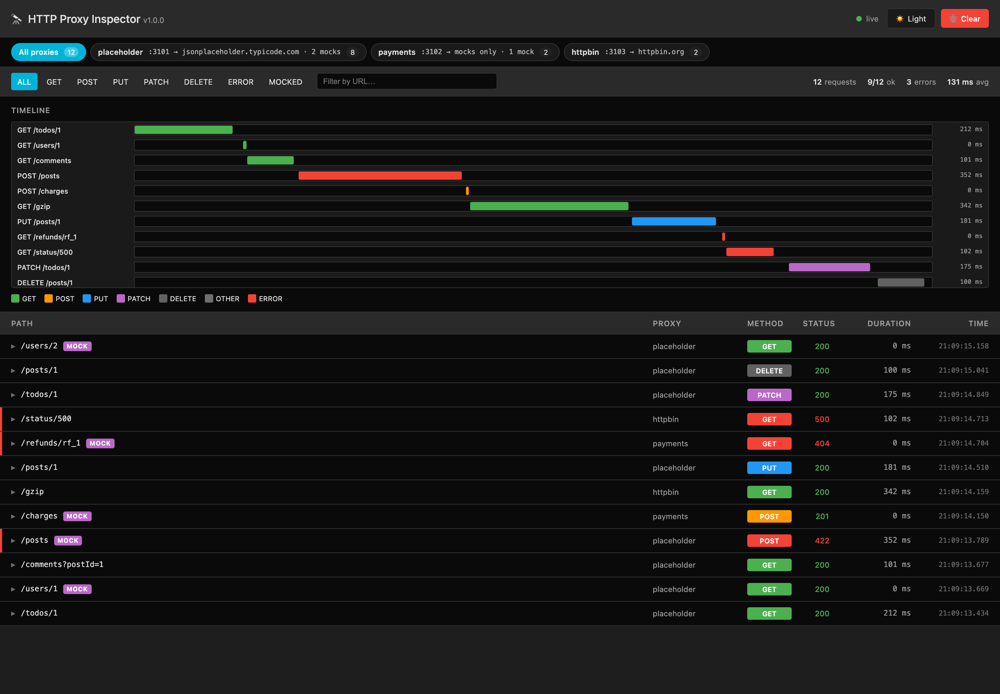
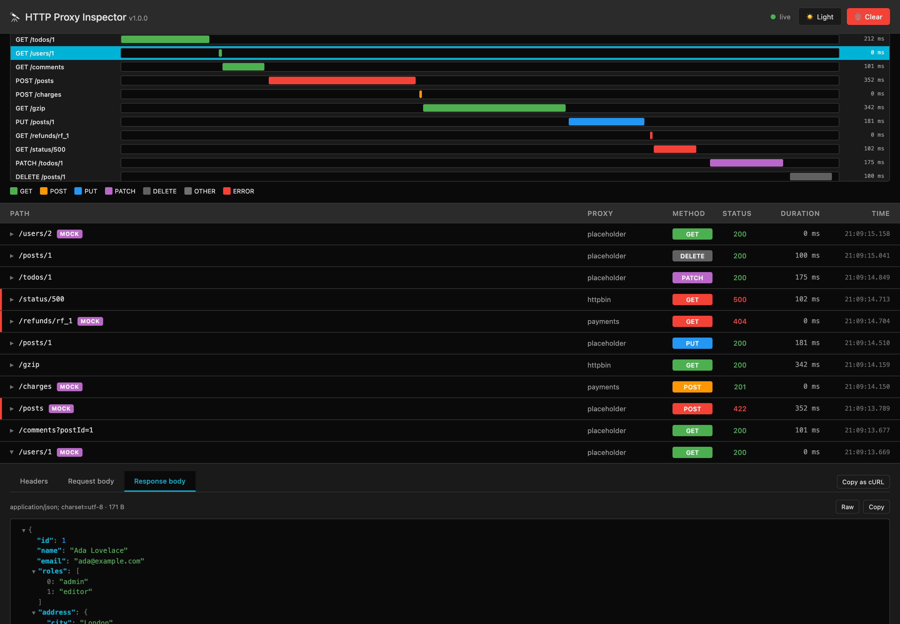

# HTTP Proxy Inspector

[](https://www.npmjs.com/package/http-proxy-inspector)
[](https://github.com/JhonSteven/http-proxy-inspector/actions/workflows/ci.yml)
[](LICENSE)

**Local proxies that forward to your real APIs and capture every request and response in a web UI.** It works with any HTTP client: Next.js server components and route handlers, the browser, mobile apps or scripts.

```
 your app ──► http://localhost:3001 ──► https://api.users.com
          ──► http://localhost:3002 ──► https://api.payments.com
                       │
                       ▼
              http://localhost:4000   (web UI: live list, timeline, headers, bodies)
```



- 🔀 **Many proxies, one process**: one local port per API, all shown in the same UI.
- 🔍 **Full capture**: method, URL, headers, query, request and response bodies (gzip/brotli/deflate decoded, plus zstd on Node 22.15+), status and timings.
- 🎭 **Mock responses**: simulate any endpoint with a status, headers, body and delay; edits apply as soon as you save.
- 🌊 **Streaming-safe**: responses are piped as they arrive, so SSE and large downloads are not buffered.
- 🧭 **Transparent**: rewrites `Host`, redirects and cookie domains so clients stay on the proxy; answers CORS preflights for localhost origins.
- 🔒 **Local only**: binds to localhost and rejects foreign `Host` headers. No runtime dependencies.

> ⚠️ Development tool. Do not expose it publicly or use it in production.

## Installation

```bash
npm install --save-dev http-proxy-inspector
```

Requires Node.js 22 or newer.

## Quick start

1. Create a config file in your project root:

   ```bash
   npx http-proxy-inspector init
   ```

2. Point each proxy at a real API (`http-proxy-inspector.config.json`):

   ```json
   {
     "ui": { "port": 4000 },
     "proxies": [
       { "name": "users", "port": 3001, "target": "https://api.users.com" },
       { "name": "payments", "port": 3002, "target": "https://api.payments.com/v1" }
     ]
   }
   ```

3. Make your app call the proxy instead of the real API, for example in `.env.development`:

   ```bash
   USERS_API_URL=http://localhost:3001
   PAYMENTS_API_URL=http://localhost:3002
   ```

   A request to `http://localhost:3002/charges?limit=5` is forwarded to `https://api.payments.com/v1/charges?limit=5`.

4. Start the inspector and your dev server together:

   ```json
   {
     "scripts": {
       "dev": "next dev",
       "dev:inspect": "http-proxy-inspector -- next dev"
     }
   }
   ```

   Everything after `--` runs as a child process; the proxies stop when it exits.

5. Open [http://localhost:4000](http://localhost:4000).

Keep the real URLs in `.env.production` (or your deployment settings) so production never goes through the proxy.

## Configuration

The CLI looks for `http-proxy-inspector.config.json`, `.js`, `.mjs` or `.cjs` in the current folder (or use `--config <file>`). JavaScript configs can read environment variables and get autocompletion through `defineConfig`:

```js
// http-proxy-inspector.config.mjs
import { defineConfig } from 'http-proxy-inspector';

export default defineConfig({
  proxies: [
    { name: 'users', port: 3001, target: process.env.USERS_API_TARGET ?? 'https://api.users.com' },
  ],
});
```

| Option | Default | Description |
| --- | --- | --- |
| `proxies[].port` | required | Local port for this proxy. |
| `proxies[].target` | required unless `mocks` | Real URL to forward to. May include a base path; no query string. |
| `proxies[].mocks` | `[]` | Simulated responses, see [Mock responses](#mock-responses). |
| `proxies[].name` | target host | Label shown in the UI and terminal. |
| `proxies[].changeOrigin` | `true` | Send the target's host in the `Host` header and strip `Domain` from `Set-Cookie`. |
| `proxies[].secure` | `true` | Verify TLS certificates. Set `false` for self-signed targets. |
| `proxies[].cors` | `true` | `true`: answer preflights and allow localhost origins. `string[]`: allow those origins. `false`: pass CORS through untouched. |
| `proxies[].timeout` | none | Fail the request after this many ms without upstream activity. |
| `ui.port` | `4000` | Port for the web UI. |
| `ui.enabled` | `true` | Set `false` to run only the proxies. |
| `host` | `localhost` | Interface to bind. `localhost` listens on both 127.0.0.1 and ::1. |
| `maxEntries` | `500` | Requests kept in memory; older ones are dropped. |
| `maxBodySize` | `1048576` | Bytes captured per body. Bodies are always forwarded whole. |

## Mock responses

Add `mocks` to a proxy to answer some endpoints with a simulated response instead of calling the real API. Requests that no mock matches are still forwarded to the `target`.

```json
{
  "proxies": [
    {
      "name": "users",
      "port": 3001,
      "target": "https://api.users.com",
      "mocks": [
        { "method": "GET", "path": "/users/:id", "body": { "id": 1, "name": "Ada Lovelace" } },
        { "method": "POST", "path": "/users", "status": 422, "body": { "error": "Email already taken" }, "delay": 800 },
        { "path": "/reports/*", "status": 503, "headers": { "Retry-After": "30" } },
        { "method": "GET", "path": "/search", "query": { "q": "empty" }, "body": [] },
        { "method": "DELETE", "path": "/users/:id", "status": 204, "enabled": false }
      ]
    },
    {
      "name": "payments",
      "port": 3002,
      "mocks": [{ "method": "POST", "path": "/charges", "status": 201, "body": { "id": "ch_123", "status": "succeeded" } }]
    }
  ]
}
```

| Field | Default | Description |
| --- | --- | --- |
| `path` | required | Path relative to the proxy. `:name` matches one segment, `*` matches anything. |
| `method` | any | HTTP method to match. |
| `query` | none | Query parameters that must be present with exactly these values. |
| `status` | `200` | Response status (200–599). |
| `headers` | none | Response headers. |
| `body` | empty | Strings are sent as-is (`text/plain`); objects, arrays, numbers and booleans as JSON. |
| `delay` | `0` | Milliseconds to wait before answering, to simulate a slow API. |
| `enabled` | `true` | Set `false` to keep a mock in the file without using it. |

- Mocks are checked in order and the first match wins.
- A proxy without `target` only serves mocks and answers 404 to anything else, which is handy while the real API does not exist yet.
- The CLI watches the config file: change a status, body or delay, save, and the next request uses it. Adding or removing proxies still needs a restart.
- Mocked requests show a **MOCK** tag in the UI and in the terminal, and the **MOCKED** filter lists only them.



## CLI

```
http-proxy-inspector [options] [-- <command...>]
http-proxy-inspector init

  -c, --config <file>     Config file
  -p, --proxy <spec>      Add a proxy: <port>=<target> or <name>:<port>=<target> (repeatable)
      --ui-port <port>    Port for the web UI (default: 4000)
      --no-ui             Do not start the web UI
      --host <host>       Interface to bind (default: localhost)
  -q, --quiet             Do not log each request in the terminal
  -h, --help              Show help
  -v, --version           Show the version
```

`--proxy` works without a config file and replaces a configured proxy on the same port:

```bash
npx http-proxy-inspector -p users:3001=https://api.users.com -p payments:3002=https://api.payments.com
```

## The UI

- Live list of requests (newest first) with proxy, method, status, duration and time.
- Filters by proxy, method, errors or mocked requests, plus a URL search.
- Timeline of the most recent requests.
- Details per request: upstream URL, timings, query parameters, request and response headers, and bodies as a collapsible JSON tree, form table or raw text.
- **Copy as cURL** to replay a request against the real API.
- Light and dark themes (follows your system setting until you pick one).

Captured data lives in the inspector's memory: reloading the page keeps it, restarting the inspector clears it.

## Programmatic use

```js
const { startInspector } = require('http-proxy-inspector');

const inspector = await startInspector({
  proxies: [{ name: 'users', port: 3001, target: 'https://api.users.com' }],
});

inspector.store.on('update', entry => {
  if (entry.state !== 'pending') console.log(entry.method, entry.url, entry.response?.status);
});

await inspector.close();
```

## Limitations

- WebSocket upgrades are not proxied.
- Next.js only calls the proxy when a `fetch` actually goes to the network. Responses served from the Next.js Data Cache never reach it.
- Bodies larger than `maxBodySize` are captured partially; compressed bodies that get truncated cannot be decoded.

## Migrating from next-http-inspector

This project used to be published as `next-http-inspector` (a Next.js fetch interceptor) plus `next-http-inspector-server` (the UI). Both are replaced by this package:

1. Swap the packages:

   ```bash
   npm uninstall next-http-inspector next-http-inspector-server
   npm install --save-dev http-proxy-inspector
   ```

2. Remove `initFetchServerInterceptor()` from your layout.
3. Create a config with `npx http-proxy-inspector init` and point your API base URLs at the proxies.

## Development

```bash
npm install
npm test        # builds and runs the test suite
npm run dev     # TypeScript watch mode
```

### Project structure

```
src/
  cli.ts        CLI: flags, init, startup banner, per-request log, "-- <command>" mode
  config.ts     Loads and validates the config file and merges --proxy flags
  inspector.ts  startInspector(): starts every proxy and the UI
  proxy.ts      Serves mocks or forwards requests with streaming; handles CORS, redirects, cookies and 502s
  body.ts       Captures bodies up to maxBodySize and decodes compressed ones
  store.ts      In-memory ring buffer of captured requests, with change events
  uiServer.ts   Serves the UI, its JSON API and live updates (Server-Sent Events)
  types.ts      Public config and request types
ui/             Web UI in plain JavaScript (no build step, no CDN)
test/           node:test suites for the proxy, mocks, the UI API and the config
```

The UI is a static page that talks to the inspector through these endpoints:

| Endpoint | Description |
| --- | --- |
| `GET /api/info` | Version and running proxies. |
| `GET /api/requests` | Summaries of every captured request. |
| `GET /api/requests/:id` | One request with headers and bodies. |
| `DELETE /api/requests` | Clears the history. |
| `GET /api/events` | Live updates as Server-Sent Events. |

## Contributing

Issues and pull requests are welcome at [github.com/JhonSteven/http-proxy-inspector](https://github.com/JhonSteven/http-proxy-inspector). Please run `npm test` before opening a pull request; CI runs the same suite on Node.js 22, 24 and 26.

## License

[MIT](LICENSE)
